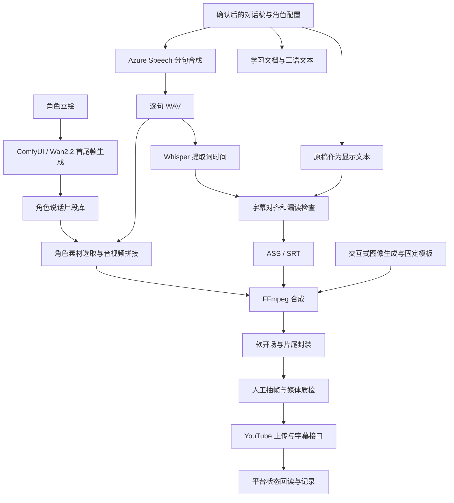

# 架构与数据流

## 当前实现

这是生产流程说明图，包含 AI/人工协调动作；没有声称所有节点已经被一个调度器自动执行。`build_episode.py` 从已存在 WAV 开始编排主要视频加工阶段，TTS 与最终封装是独立步骤。平台状态回读有 API 脚本和历史记录，完整发布收尾仍由工作流协调。

## 数据契约

| 边界 | 当前文件格式 | 关键约束 |
|---|---|---|
| 脚本 → TTS | UTF-8，每行 `角色: 内容` | 角色到声音映射，顺序编号 |
| TTS → 媒体处理 | 单句 WAV | 正式规格为 48 kHz、PCM 16-bit、单声道 |
| Whisper → 对齐 | JSON `cues: [[{w,start,end}]]` | cue 与脚本轮次对应，时间单位秒 |
| 对齐 → 字幕渲染 | ASS/SRT | 正文来自脚本，识别结果提供时间参考 |
| SNC 三语文本 | 每组三行：中文、拼音、英文 | 拼音音节数结构检查；语境读音另审 |
| 主片 → 发布字幕 | SRT 时间轴 | 使用一秒软开场时，上传字幕整体 +1.0 秒 |

## 状态与恢复的实际程度

状态主要由文件是否存在、输出目录和控制台日志体现。部分步骤复用缓存、允许跳过或按句重做；尚无持久任务队列、输入版本摘要驱动的缓存失效和完整事务保证。跨阶段的文件命名是一种隐式接口，后续可改为统一项目配置与产物清单。

## 上游角色素材生成

ComfyUI 节点图及 Python API 调用方式见 [角色片段生成说明](08_ComfyUI角色片段生成.md)。该支路以图片和动作提示词为输入，生成素材后再与 TTS 配音合并。
