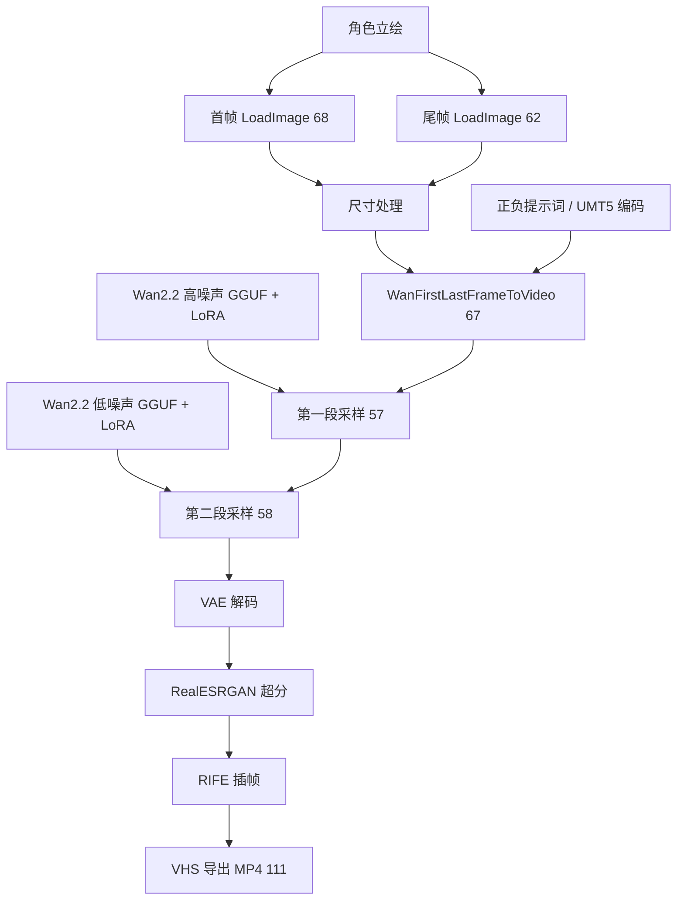

# ComfyUI / Wan2.2：从人物立绘到可复用对话片段

这一部分是对话视频生产的上游 AI 视频生成能力：在 ComfyUI 中使用 Wan2.2 图生视频工作流，将角色立绘生成自然说话动作片段，再通过 Python API 批量调度、命名和归档为角色素材库。

## 1. 输入和实际片段

| 角色 | 输入立绘 | 历史生成片段 |
|---|---|---|
| Maya | [立绘 PNG](../cases/comfyui/maya_portrait.png) | [片段 MP4](../cases/comfyui/maya_clip_001.mp4) |
| Ethan | [立绘 PNG](../cases/comfyui/ethan_portrait.png) | [片段 MP4](../cases/comfyui/ethan_clip_001.mp4) |

以上文件来自现有角色设定图与匹配的 smart-casual 说话素材目录。配置为每个角色生成 5 个变体，通过随机 seed 获得不同的小动作。没有保留逐片生成记录与 prompt_id 的完整对应，因此这些样例证明已有素材产物，不应声称已用当前工作流快照逐片精确复现。

## 2. ComfyUI 工作流

完整 [API 工作流 JSON](../source/skills/dialogue-portrait-videos/examples/wan_api.json) 已附，保留 41 个节点。这是可供 API 提交的节点图，不包含编辑器节点位置布局。模型权重、自定义节点代码和安装环境不在包内。



**首尾帧约束：** Python 将同一人物立绘写入两个 LoadImage 节点，以约束片段开始和结束的身份、姿势及构图。提示词要求人物保持坐姿，做嘴唇开合、轻微点头和少量手势，背景稳定。相同首尾图有利于片段衔接，但不保证绝对无缝，需要检查生成结果。

**当前工作流快照中的参数：** Wan2.2 I2V 14B 高/低噪声 Q4_K_M GGUF、Wan VAE、UMT5 编码器、LightX2V LoRA；8 步采样分两段执行，CFG 1、Euler；长边输入参数 720，长度表达式 `10×16+1=161` 帧；后续配置 RealESRGAN x2、RIFE 4 倍插帧和 60 fps 导出。这些是快照配置值，不是模型通用默认值，也不代表所有历史素材使用了相同参数。

本次核验的 Maya 历史样例为约 10.68 秒、720×400、60 fps、无音轨。样例的最终尺寸与当前快照的超分配置不能直接等同，应分别理解为历史成品参数和当前节点设置。

## 3. Python 如何调用 ComfyUI

源码：[generate.py](../source/skills/dialogue-portrait-videos/scripts/generate.py)

1. 读取 JSON：工作流路径、ComfyUI 地址、人物列表、输出目录、节点 ID、每人片段数量。
2. 把人物图片复制到 ComfyUI input 目录，生成唯一前缀文件名。
3. 复制工作流模板，覆盖首尾图、动作提示词、随机 seed 和输出前缀。
4. 向 `POST /prompt` 提交 `{"prompt": 工作流, "client_id": UUID}`，取得 `prompt_id`。
5. 轮询 `GET /history/{prompt_id}`，检查任务状态，查找返回的 MP4/WebM/MOV 信息。
6. 将 ComfyUI 输出移动到目标人物文件夹，按 `001.mp4` 等序号归档。

`submit` 对连接失败进行有限重试；HTTP 错误直接报告。`wait_for` 带轮询间隔和超时。`--skip-existing` 跳过已有目标文件，`--limit` 限制本次任务数量，`--dry-run` 仅打印任务计划。当前批次按片段顺序提交并等待，并非多个 GPU worker 并行调度。

这一层体现的是：工作流节点参数化、API 任务提交、异步任务状态轮询、文件接口衔接、批处理和素材复用。ComfyUI 默认服务端使用本地地址；当前程序依赖可直接访问的 ComfyUI 输入输出目录，仅修改 API 地址不能自动支持远程文件传输。

## 4. 配置和格式转换

- [原生产配置](../source/skills/dialogue-portrait-videos/examples/sne_podcast_smart_casual.json)：保留原目录约定，作为源码证据。
- [Demo 配置](../source/skills/dialogue-portrait-videos/examples/demo.example.json)：图片引用改为包内样例，适合 dry-run。
- [wf_to_api.py](../source/skills/dialogue-portrait-videos/scripts/wf_to_api.py)：将编辑器 workflow JSON 转成 API 节点图，结合对象信息处理 widget、连接和 bypass。附源码供参考，本次没有执行该转换。

在包根目录执行以下命令，可以核验两个人物任务的配置与路径，不需要启动 ComfyUI：

```sh
python source/skills/dialogue-portrait-videos/scripts/generate.py --config source/skills/dialogue-portrait-videos/examples/demo.example.json --dry-run --limit 2
```

`--limit 2` 按任务顺序显示前两个 Maya 片段；移除 `--limit 2` 可显示两人共 10 个计划任务。首次完整推理还需要 ComfyUI、对应节点和模型、实际 input/output 路径及足够算力。本次整理只执行 dry-run，没有进行新的 GPU 推理。

## 5. 片段如何进入长对话

生成的短片段形成角色素材库。后续 `gen_videos.py` 按角色、场景、服装选择素材，依据单句音频时长选取并拼接片段，再由 `merge_audio_video.py` 合入该句 TTS 音轨，按轮次拼成整期。

当前这条 Wan2.2 支路的输入是人物图和动作提示词，没有把每句 TTS 音频送入模型，因此它生成的是通用说话动作。逐句配音匹配和字幕对齐在后续完成；本包不将它描述为逐音素精确口型同步系统。

## 设计取舍

角色素材生成和每期视频合成分阶段运行：同一套人物动作片段可以用于不同节目，便于复用、替换和单独检查。ComfyUI 工作流负责图生视频，Python 负责参数化、任务状态和产物归档，FFmpeg 负责后续时长匹配与合成。精确音频驱动口型需要增加独立处理链。
